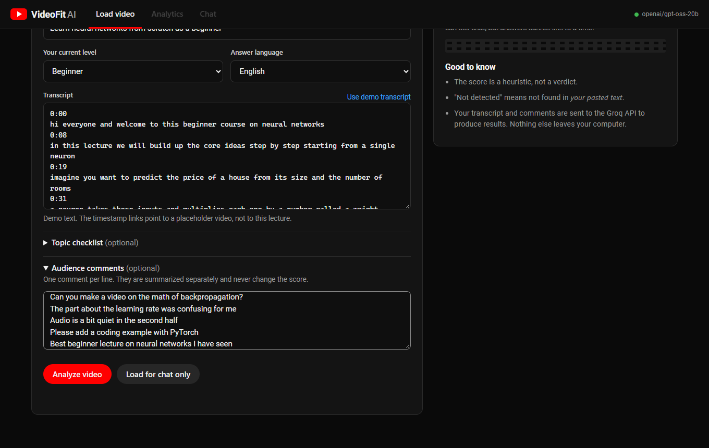

# VideoFit AI

Is this YouTube video right for what you want to learn? Paste the video link and its transcript, say what you want to
learn and your level, and VideoFit AI gives you an explainable fit report and a chat where every answer points to the
exact moment in the video.



<!-- After running `python -m scripts.make_screenshots`, uncomment these:


-->

## What it does

- **Analytics dashboard:** a 0 to 100 learning-fit score with a breakdown, topic coverage (covered, partial, not
  detected), explanation depth, examples, level fit, strengths, limitations and next topics. Each topic shows the
  transcript evidence with a clickable timestamp, and an evidence timeline shows where in the video your topics appear.
- **Chat with the video:** questions are answered from the transcript with clickable timestamp links. It handles
  follow-ups, says so when the transcript does not cover something, and keeps the instructor's words separate from
  outside knowledge.
- **Multilingual:** transcripts and questions in English, Hindi, Marathi and Hinglish (Romanized Hindi). You choose the
  answer language, or ask for one in the question ("explain that in Hindi").
- **Optional audience comments:** summarized into questions, praise, difficulties and complaints, kept separate from
  the score.

You paste the transcript yourself. VideoFit does not fetch transcripts or scrape YouTube.

## Quick start

Tested on Windows 11 with Python 3.12. Other platforms are untested.

```bash
python -m venv .venv
.venv\Scripts\activate
pip install -r requirements.txt
copy .env.example .env
```

Open `.env` and set `GROQ_API_KEY` (free key at <https://console.groq.com/keys>). Then:

```bash
python -m uvicorn app.api.main:app --port 8000
```

Open <http://localhost:8000>. The first time you load a transcript, a 470 MB embedding model is downloaded once.

Run the tests (no API key or model download needed, they use fakes):

```bash
python -m pytest -q
```

### Configuration (`.env`)

| Variable | Default | Notes |
|---|---|---|
| `GROQ_API_KEY` | (none) | Required for analysis and chat |
| `LLM_MODEL` | `openai/gpt-oss-120b` | Available models differ per Groq account |
| `EMBEDDING_MODEL` | `intfloat/multilingual-e5-small` | `BAAI/bge-m3` is an optional quality mode: about 5 points better hit@1 on the small synthetic test, about 11x slower indexing, 2.2 GB |
| `CHROMA_DIR` | `chroma_db` | Vector index location |

## Using it

1. Open a video on YouTube, click **...more** under the description, then **Show transcript**. In the transcript menu,
   turn on **Toggle timestamps**, then copy all the lines.
2. Paste the URL and transcript, describe your goal, choose your level, and press **Analyze video**.
3. Read the dashboard, then open **Chat** to ask questions. Click a timestamp to jump to that moment.

Press **Use demo transcript** to try it without YouTube. The demo links point to a placeholder video, not to that
lecture, so the timestamps only demonstrate the interface.

### Sample inputs (`samples/`)

| File | What it is |
|---|---|
| `english_neural_networks_demo.txt` | 7-minute synthetic beginner lecture, YouTube paste style (used by the evaluation) |
| `english_youtube_paste.txt` | tiny 5-line English example |
| `hinglish_youtube_paste.txt` | Romanized Hindi with English terms |
| `hindi.srt` | Hindi in Devanagari, SRT format |
| `marathi.srt` | Marathi in Devanagari, SRT format (synthetic, not reviewed by a native speaker) |

### A 3-minute demo

1. Press **Use demo transcript**, add a few lines of comments, and press **Analyze video** (about a minute).
2. On the dashboard: the score ring, the breakdown with explanations, the evidence timeline (click a marker), and the
   "Not detected" CNN card (the lecture only names it as the next video).
3. In Chat: "How does a single neuron compute its output?", then "Now explain that in simple Hindi", then "Explain
   transformers" (it refuses honestly), then "What's the weather?" (it declines as unrelated).
4. Back on the dashboard, press **Reuse this checklist** to re-run with the same topics and compare scores.

## How it works

Parse the transcript into timestamped segments, group them into chunks, embed them locally, store them in Chroma. A
question is rewritten to stand alone, a small tool-calling agent searches the index, the top 4 chunks go to the LLM,
and Python checks every citation before showing it. The analysis builds a topic checklist from your goal, assesses
each topic against retrieved evidence, and computes the score in Python.

Full diagrams and design notes: [docs/architecture.md](docs/architecture.md).

## Project layout

```
app/
  ingestion/   youtube.py (URL, links)  transcript.py (text / SRT / VTT parsing)
  rag/         chunking.py  store.py (embeddings + Chroma)  tools.py (agent tools)
  analysis/    rubric.py (scoring)  assessor.py (topic assessment)  comments.py
  chat/        answerer.py (grounded answers, citation validation)
  graph/       chat_graph.py  analysis_graph.py (LangGraph workflows)
  api/         main.py (FastAPI + static UI)
  schemas.py   Pydantic models      llm.py  config.py
ui/            index.html  style.css  app.js (no build step)
tests/         106 tests, no network needed
eval/          gold data, results, RESULTS.md
scripts/       command-line demos and evaluation runners
samples/       example transcripts
docs/          architecture and notes
```

## Evaluation

Measured on one synthetic lecture with labels written by the same author, so treat these as a sanity check, not as
accuracy on real videos. Full details and caveats: [eval/RESULTS.md](eval/RESULTS.md).

| Check | Result |
|---|---|
| Answer inside the 4 retrieved chunks | 13 / 13 questions |
| Citations whose quote and timestamp match the transcript | 100% |
| Unanswerable questions refused | 5 / 5 |
| Topic present vs not detected | 100% (52 judgements) |
| Exact coverage label | 92% |
| Score spread, same fixed checklist | SD 1.0 over 4 runs |
| Score spread, auto-generated checklist | SD 4.2 over 4 runs |
| Same lecture, advanced goal | 28 (vs about 69 for the beginner goal) |

Not evaluated: real YouTube transcripts, long videos, whether every sentence of an answer is supported by its
citations, and Hindi or Marathi answers by a native speaker.

## Limitations

- **Heuristic score.** The 40/25/15/10/10 weights are a starting point, not a validated measure. "Not detected" means
  not found in the pasted text, not proof the video never covers it.
- **Free tier budget.** One analysis uses roughly 16,500 tokens. Groq's free tier allows 200,000 tokens per day per
  model, so about a dozen analyses a day plus some chat.
- **Auto-generated topic lists vary** between runs, so the score moves a few points. Use **Reuse this checklist** or
  type your own topics for comparable scores.
- **Memory only.** Reports and chat history are lost when the server restarts. Only the vector index is saved.
- **Transcripts are sent to the Groq API.** Nothing else leaves your computer.
- **Embedded player.** The in-page YouTube player could not be verified in the test environment; every citation also has
  a link that opens YouTube directly.
- **Single user, local use.** There is no authentication and the backend is not hardened for the public internet.

## Design decisions

- **No Docker, CI or extra infrastructure.** Setup is `pip install` plus one command, and the real cost is the
  model download, which Docker would not remove. These can be added when a concrete need appears.
- **Plain HTML/CSS/JS instead of Streamlit** for full control of the film-room look, with no build step.
- **Local embeddings** keep transcripts off third-party embedding services and cost nothing.
- **Python owns the facts.** Scores, quotes, timestamps and links are computed or verified in code, never trusted
  from the model.

## Not implemented

Automatic transcript or comment fetching (deliberately out of scope), saved reports across restarts, streaming
progress, user accounts, and human-reviewed benchmarks.
