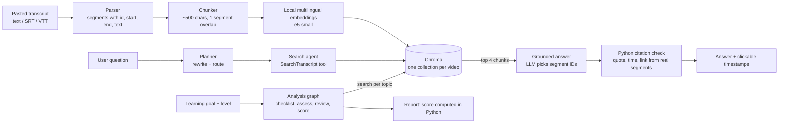
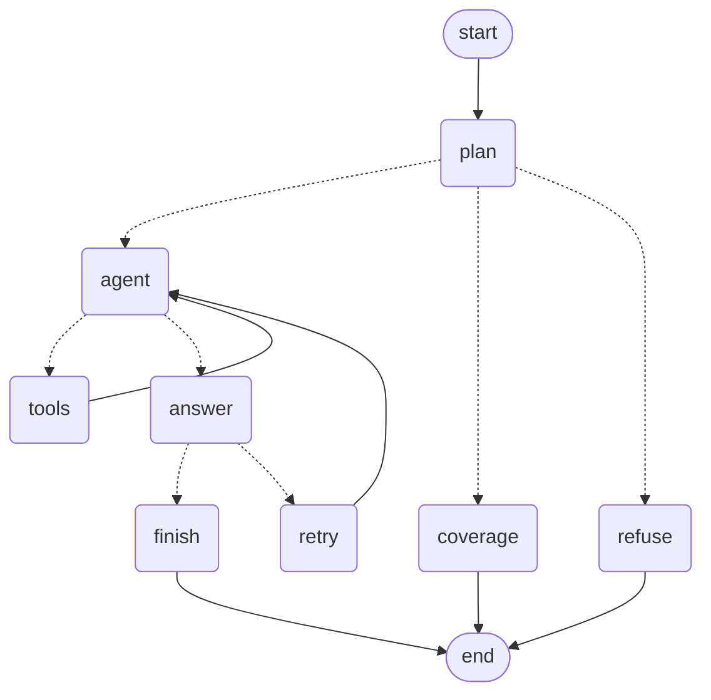
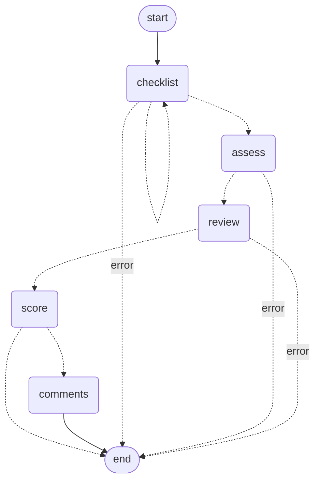

# Architecture

VideoFit AI is a modular monolith: one FastAPI process serves the API and a plain HTML/CSS/JS front end. There are no
queues, no extra databases and no separate services. The only things on disk are the Chroma vector index and the
local embedding model cache. Sessions and chat history live in memory.

## Data flow

Key rule: **the LLM never produces a quote, timestamp or link.** It only names segment IDs. Python looks those IDs up in
the retrieved transcript, drops any that do not exist, and builds everything shown to the user.

## Chat workflow (LangGraph)

`plan` rewrites the question so it stands alone and routes it. Transcript questions go through a tool-calling
`agent` loop (at most 3 rounds) that gathers evidence, then `answer`. If no evidence is found, one `retry` with
different wording is allowed. Coverage questions are answered from the report with no LLM call, and unrelated
questions are refused without any search.

## Analysis workflow (LangGraph)

Dashed edges are conditional. The checklist step retries once. Any step that fails ends the run with a readable error.
The optional `comments` branch runs only if comments were supplied, and a failure there never breaks the report.

(These diagrams were checked against the compiled graphs with `graph.get_graph().draw_mermaid()`.)

## Three kinds of memory

| Kind | Where | Lifetime |
|---|---|---|
| Conversation history | the `messages` list the caller keeps and passes back each turn | one chat (in memory, last 20 messages) |
| Graph state | LangGraph state (retrieved chunks, attempt count, tool messages) | one run |
| Long-term storage | Chroma index on disk | until the transcript is loaded again |

No LangGraph checkpointer or database is used because nothing needs one yet.

## Trust boundaries

- Transcripts and comments are untrusted data. They are placed in delimited blocks of the user message, never in the
  system prompt, and every prompt tells the model not to follow instructions found inside them.
- The agent's two tools are read-only and take one short text argument.
- Citation integrity does not depend on the model behaving: it is enforced in Python.

## Scoring

The model judges each topic (coverage, depth, example) from retrieved evidence. If it claims coverage without citing a
real segment, Python downgrades the topic to "not detected". All arithmetic is in `app/analysis/rubric.py`:
coverage 40%, depth 25%, examples 15%, level fit 10%, clarity 10%. These weights are a starting heuristic, not a
validated measure.
